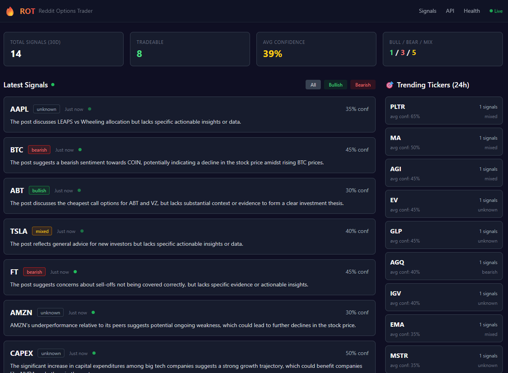
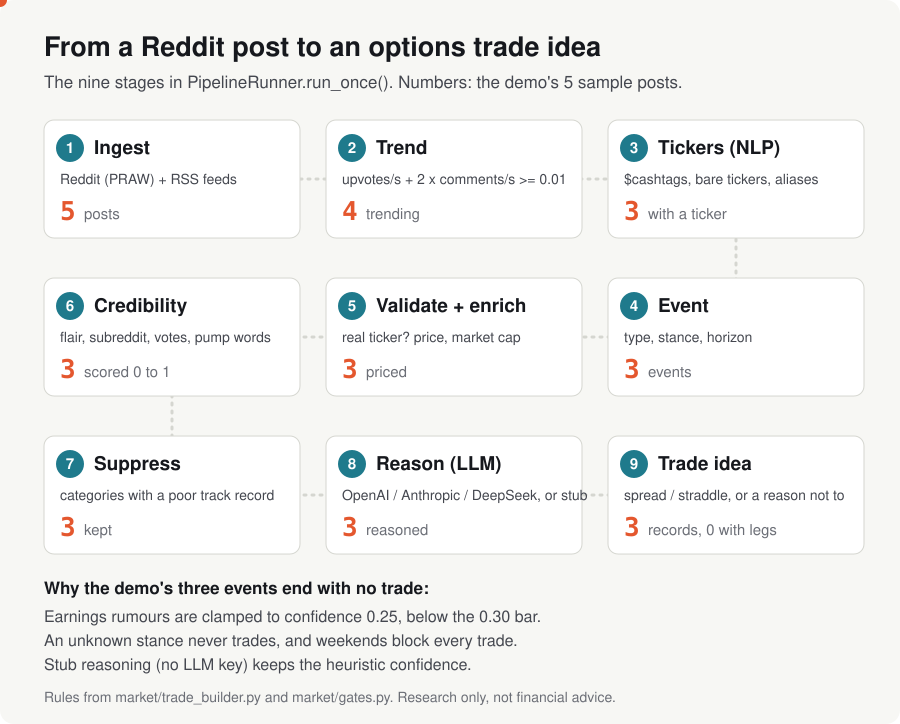

# Reddit Options Trader (ROT)

[English](README.md) | [简体中文](README.zh-CN.md) | [日本語](README.ja.md) | 한국어

**Reddit과 시장 뉴스를 읽고, 사람들이 갑자기 열광하는 종목 티커를 찾아내고, 각 게시물이 얼마나 믿을 만한지 점수를 매긴 뒤, 이를 옵션 매매 아이디어나 매매하지 않을 분명한 이유로 바꿔 주는 Python 앱입니다.** Reddit 감성 분석과 옵션 신호 파이프라인으로, 웹 대시보드, REST/WebSocket API, 선택적인 LLM 추론(OpenAI, Anthropic, DeepSeek)을 갖추고 있습니다.

Reddit 감성을 매매 신호로 연구해 보고 싶은 개발자와 개인 옵션 트레이더, 그리고 소셜 미디어 NLP 파이프라인이 처음부터 끝까지 어떻게 만들어지는지 궁금한 분들을 위한 프로젝트입니다.

<p align="center">
  <a href="https://tensorust.com/Reddit-Options-Trader-ROT-/"><b>프로젝트 사이트</b></a> &middot;
  <a href="#try-it-in-one-command">실행해 보기</a> &middot;
  <a href="#how-it-works">작동 원리</a> &middot;
  <a href="#examples">예제</a> &middot;
  <a href="docs/REFERENCE.md">전체 레퍼런스</a>
</p>


[](https://www.python.org/downloads/)
[](LICENSE)

> [!WARNING]
> **연구 및 교육용 도구일 뿐이며 투자 조언이 아닙니다.** ROT가 만드는 것은 신호와 매매 아이디어이지, 검증된 전략이 아닙니다. 옵션은 지불한 프리미엄의 100%를 잃을 수 있고, Reddit 감성은 잡음이 많고 조작되는 경우도 잦으며, LLM 추론은 자신 있게 틀릴 수 있습니다. 브로커 연동은 기본값이 모의투자입니다.



*로컬에서 실행 중인 대시보드(2026년 2월 스크린샷, 실시간 Reddit 데이터).*

<a id="try-it-in-one-command"></a>
## 명령어 하나로 실행해 보기

Reddit 계정도 API 키도 필요 없습니다. 데모는 함께 들어 있는 샘플 게시물 다섯 개로 실제 파이프라인을 돌립니다.

```bash
git clone https://gitlab.com/mattbusel/Reddit-Options-Trader-ROT.git && cd Reddit-Options-Trader-ROT-
pip install -e . && python examples/demo.py
```

Python 3.10 이상이 필요합니다. [`examples/sample/posts.json`](examples/sample/posts.json)의 샘플 게시물은 데모용으로 작성한 것입니다(실제 Reddit 게시물이 아닙니다). 티커 확인과 가격은 2026-09-28에 저장한 Yahoo Finance 스냅샷을 쓰므로 오프라인에서 실행됩니다. 최신 가격을 쓰려면 `--live`를 붙이세요.

실시간 Reddit 데이터와 대시보드로 전체 앱을 실행하려면 `.env.example`을 `.env`로 복사하고, Reddit API 키를 넣은 뒤 `docker compose up --build`를 실행하세요(그다음 http://localhost:8000/dashboard 를 엽니다). 호스팅된 인스턴스는 없습니다. 예전 Railway 배포는 내려가 있습니다.

<a id="how-it-works"></a>
## 작동 원리

<picture>
  <source media="(prefers-color-scheme: dark)" srcset="docs/img/pipeline-dark.svg">
  
</picture>

쉽게 말하면, 폴링할 때마다(기본값으로 Reddit을 20초마다 폴링) 다음을 합니다.

1. **수집과 트렌드 판단.** 게시물은 Reddit과 RSS 뉴스 피드에서 들어옵니다. 두 번의 폴링 사이에 추천 수와 댓글 수가 빠르게 늘면 그 게시물은 "트렌드"가 됩니다.
2. **티커와 이야기 찾기.** 자체 제작한 NLP 엔진이 `$TSLA` 같은 티커, 이벤트 종류(실적 루머, 제품 뉴스, 숏스퀴즈 이야기 등), 관점(강세, 약세, 혼조), 기간을 뽑아냅니다. 티커는 실제 시장 데이터로 확인합니다.
3. **신뢰도 채점.** 0에서 1 사이의 신뢰도 점수는 DD 게시물(심층 분석 글), 좋은 서브레딧, 참여도에 가점을 주고, 교차 게시물, 신규 계정, 펌프 앤드 덤프식 표현에 감점을 줍니다.
4. **추론과 결정.** LLM(키가 없으면 내장 스텁)이 매매 논리를 쓰고, 트레이드 빌더가 구조(데빗/크레딧 스프레드, 스트래들 등)를 제안하거나 매매하지 않는 이유를 기록합니다.

코드: [`src/rot/app/runner.py`](src/rot/app/runner.py)(`PipelineRunner.run_once`). 다이어그램 소스: [`scripts/make_pipeline_svg.py`](scripts/make_pipeline_svg.py).

<a id="examples"></a>
## 예제

2026-09-28에 `python examples/demo.py`를 실행한 실제 출력입니다(스텁 추론, 함께 들어 있는 시장 스냅샷).

```text
ROT demo: the real 9-stage pipeline on 5 sample posts (two polls, 10 minutes apart)
market data: bundled Yahoo Finance snapshot from 2026-09-28 (use --live for fresh data)
LLM reasoning: stub mode (no ROT_LLM_API_KEY)

pass 1: snapshots 5, candidates 0, events 0, trade_ideas 0
pass 2: snapshots 5, candidates 4, events 3, trade_ideas 3
  (pass 1 has nothing to compare with, so nothing can trend yet)

r/options  "NVDA DD: data center demand still outrunning supply into next quarter"
  poll: 420 -> 610 upvotes, 88 -> 131 comments
  event: earnings_rumor, bullish, horizon earnings, tickers NVDA
  credibility: 0.70   last close $228.86
  reasoning: Reddit chatter mentions NVDA; treat as unverified signal.
  trade idea: none (confidence_too_low)

r/wallstreetbets  "TSLA puts printing? Deliveries miss rumor going around"
  poll: 150 -> 390 upvotes, 60 -> 142 comments
  event: earnings_rumor, bearish, horizon unknown, tickers TSLA
  credibility: 0.45   last close $357.45
  reasoning: Reddit chatter mentions TSLA; treat as unverified signal.
  trade idea: none (confidence_too_low)

r/pennystocks  "This ticker is going to the moon 1000% guaranteed, get in before it ex"
  poll: 12 -> 40 upvotes, 9 -> 30 comments
  -> no signal (no valid ticker, or not trending)

r/stocks  "AMD earnings next week: what is priced in?"
  poll: 230 -> 300 upvotes, 75 -> 110 comments
  event: earnings_rumor, unknown, horizon earnings, tickers AMD
  credibility: 0.55   last close $607.87
  reasoning: Reddit chatter mentions AMD; treat as unverified signal.
  trade idea: none (unknown_stance)

r/investing  "How do you all think about rebalancing in a high-rate world?"
  poll: 80 -> 81 upvotes, 40 -> 41 comments
  -> no signal (no valid ticker, or not trending)
```

이 출력이 보여 주는 것: r/options의 DD 게시물이 가장 높은 점수(0.70)를, r/wallstreetbets의 루머가 가장 낮은 점수(0.45)를 받았습니다. 과열된 게시물에는 티커가 없고 차분한 질문은 트렌드가 되지 않으므로 둘 다 초반에 멈춥니다. 그리고 ROT는 세 이벤트 모두 매매를 거절하며, 그 이유를 로그로 남깁니다. 모든 단계는 JSONL 감사 기록도 씁니다. `python examples/demo.py --keep`을 쓰면 디스크에 남습니다. 예:

```json
{"run_id": "run_1790631982", "trade_idea": {"underlying": "AMD", "strategy": "none", "legs": [], "max_loss": 0.0, "thesis": "Reddit chatter mentions AMD; treat as unverified signal.", "time_stop": "N/A", "quality_score": 0.0, "do_not_trade_reasons": ["unknown_stance"], "meta": {}}, "ts": 1790631982}
```

## 3단계로 사용하기

1. 위의 데모를 실행해 샘플 게시물로 모든 단계를 확인합니다.
2. [`.env.example`](.env.example)을 참고해 Reddit API 키(그리고 선택적으로 LLM 키)를 `.env`에 넣습니다.
3. 앱을 시작합니다: `docker compose up --build`, 또는 `pip install -e .` 후 `python -m rot.app.server`를 실행하고 http://localhost:8000/dashboard 를 엽니다. API 문서는 `/docs`에 있습니다.

## 문서

| 문서 | 내용 |
|---|---|
| [docs/REFERENCE.md](docs/REFERENCE.md) | 예전의 긴 README 내용 전부: 빠른 시작 옵션, 아키텍처, 신호 품질 요인, 설정, 옵션 체인, API, 데이터 계보, 브로커, 리스크 모니터, 테스트, 배포, 보안, 라운드별 기능 노트 |
| [docs/architecture.md](docs/architecture.md) | 파이프라인 단계와 설계 결정 |
| [docs/config.md](docs/config.md) | 모든 `ROT_*` 환경 변수 |
| [docs/api-reference.md](docs/api-reference.md) | REST 및 WebSocket 엔드포인트 |
| [docs/nlp-engine.md](docs/nlp-engine.md) | 자체 NLP 엔진 |
| [docs/deployment.md](docs/deployment.md) | Docker와 셀프 호스팅 |
| [SECURITY.md](SECURITY.md) · [CONTRIBUTING.md](CONTRIBUTING.md) · [CHANGELOG.md](CHANGELOG.md) | 보안 정책, 기여 방법, 변경 기록 |

## 라이선스

MIT, [LICENSE](LICENSE) 참고. 서드파티 라이선스: [THIRD_PARTY_LICENSES.md](THIRD_PARTY_LICENSES.md). 연구 및 교육용으로만 쓰세요. 작성자는 어떠한 금전적 손실에도 책임지지 않습니다. 잃어도 괜찮은 돈이 아니라면 절대 위험에 걸지 마세요.
