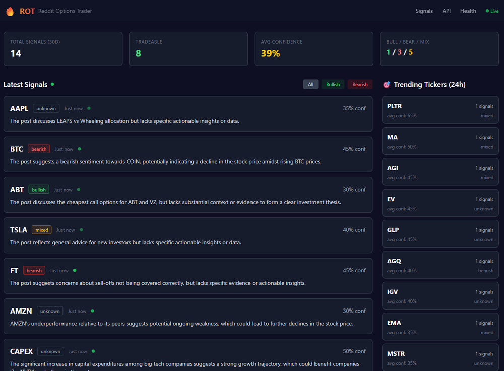
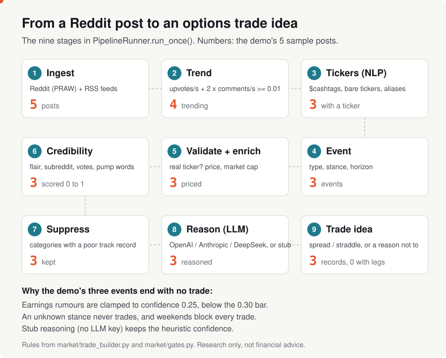

# Reddit Options Trader (ROT)

English | [简体中文](README.zh-CN.md) | [日本語](README.ja.md) | [한국어](README.ko.md)

**A Python app that reads Reddit and market news and finds the tickers people suddenly care about.** It scores how trustworthy each post looks. Then it gives an options trade idea, or a clear reason not to trade. Comes with a web dashboard, a REST/WebSocket API and optional LLM reasoning (OpenAI, Anthropic or DeepSeek).

<p align="center">
  <a href="https://tensorust.com/Reddit-Options-Trader-ROT-/"><b>Project site</b></a> &middot;
  <a href="#try-it-in-one-command">Try it</a> &middot;
  <a href="#how-it-works">How it works</a> &middot;
  <a href="#examples">Examples</a> &middot;
  <a href="docs/REFERENCE.md">Full reference</a>
</p>


[](https://www.python.org/downloads/)
[](LICENSE)

> [!WARNING]
> **Research and learning only. Not financial advice.** ROT gives signals and trade ideas, not a tested strategy. Options can lose 100% of what you pay. Reddit sentiment is noisy and often faked. LLMs can be confidently wrong. Broker hookup defaults to paper trading.



*The dashboard running locally (February 2026 screenshot, live Reddit data).*

## Try it in one command

No Reddit account, no API keys. The demo runs the real pipeline on five bundled sample posts:

```bash
git clone https://gitlab.com/mattbusel/Reddit-Options-Trader-ROT.git && cd Reddit-Options-Trader-ROT-
pip install -e . && python examples/demo.py
```

Python 3.10+. The posts in [`examples/sample/posts.json`](examples/sample/posts.json) were written for the demo, not taken from Reddit. Prices come from a Yahoo Finance snapshot saved 2026-09-28, so it runs offline. Add `--live` for fresh prices.

For the full app with live Reddit data: copy `.env.example` to `.env`, add your Reddit API keys, run `docker compose up --build`, open http://localhost:8000/dashboard. There is no hosted version. The old Railway deploy is offline.

## How it works

<picture>
  <source media="(prefers-color-scheme: dark)" srcset="docs/img/pipeline-dark.svg">
  
</picture>

On every poll (every 20 seconds by default):

1. **Pull in and trend.** Posts come from Reddit and RSS news feeds. A post "trends" when its upvotes and comments grow fast between two polls.
2. **Find the ticker and the story.** A custom NLP engine pulls out `$TSLA`-style tickers, the event type (earnings rumour, product news, squeeze chatter...), the stance (bullish, bearish, mixed) and the time horizon. Tickers are checked against real market data.
3. **Score trust.** A 0 to 1 score. DD posts, good subreddits and engagement push it up. Cross-posts, new accounts and pump-and-dump language push it down.
4. **Reason and decide.** An LLM (or a built-in stub with no key) writes a thesis. The trade builder suggests a structure (debit/credit spread, straddle...) or logs why it won't trade.

Code: [`src/rot/app/runner.py`](src/rot/app/runner.py) (`PipelineRunner.run_once`). Diagram source: [`scripts/make_pipeline_svg.py`](scripts/make_pipeline_svg.py).

## Examples

Real output of `python examples/demo.py` on 2026-09-28 (stub reasoning, bundled market snapshot):

```text
ROT demo: the real 9-stage pipeline on 5 sample posts (two polls, 10 minutes apart)
market data: bundled Yahoo Finance snapshot from 2026-09-28 (use --live for fresh data)
LLM reasoning: stub mode (no ROT_LLM_API_KEY)

pass 1: snapshots 5, candidates 0, events 0, trade_ideas 0
pass 2: snapshots 5, candidates 4, events 3, trade_ideas 3
  (pass 1 has nothing to compare with, so nothing can trend yet)

r/options  "NVDA DD: data center demand still outrunning supply into next quarter"
  poll: 420 -> 610 upvotes, 88 -> 131 comments
  event: earnings_rumor, bullish, horizon earnings, tickers NVDA
  credibility: 0.70   last close $228.86
  reasoning: Reddit chatter mentions NVDA; treat as unverified signal.
  trade idea: none (confidence_too_low)

r/wallstreetbets  "TSLA puts printing? Deliveries miss rumor going around"
  poll: 150 -> 390 upvotes, 60 -> 142 comments
  event: earnings_rumor, bearish, horizon unknown, tickers TSLA
  credibility: 0.45   last close $357.45
  reasoning: Reddit chatter mentions TSLA; treat as unverified signal.
  trade idea: none (confidence_too_low)

r/pennystocks  "This ticker is going to the moon 1000% guaranteed, get in before it ex"
  poll: 12 -> 40 upvotes, 9 -> 30 comments
  -> no signal (no valid ticker, or not trending)

r/stocks  "AMD earnings next week: what is priced in?"
  poll: 230 -> 300 upvotes, 75 -> 110 comments
  event: earnings_rumor, unknown, horizon earnings, tickers AMD
  credibility: 0.55   last close $607.87
  reasoning: Reddit chatter mentions AMD; treat as unverified signal.
  trade idea: none (unknown_stance)

r/investing  "How do you all think about rebalancing in a high-rate world?"
  poll: 80 -> 81 upvotes, 40 -> 41 comments
  -> no signal (no valid ticker, or not trending)
```

What it shows: the r/options DD post scores highest (0.70). The r/wallstreetbets rumour scores lowest (0.45). The hype post has no ticker and the calm question never trends, so both stop early. ROT refuses to trade all three events and logs why. Every stage writes a JSONL audit trail. `python examples/demo.py --keep` leaves it on disk, for example:

```json
{"run_id": "run_1790631982", "trade_idea": {"underlying": "AMD", "strategy": "none", "legs": [], "max_loss": 0.0, "thesis": "Reddit chatter mentions AMD; treat as unverified signal.", "time_stop": "N/A", "quality_score": 0.0, "do_not_trade_reasons": ["unknown_stance"], "meta": {}}, "ts": 1790631982}
```

## Use it in 3 steps

1. Run the demo above to see every stage on sample posts.
2. Put your Reddit API keys (and optionally an LLM key) in `.env`, from [`.env.example`](.env.example).
3. Start the app: `docker compose up --build`, or `python -m rot.app.server` after `pip install -e .`, and open http://localhost:8000/dashboard. API docs are at `/docs`.

## Documentation

| Document | What is in it |
|---|---|
| [docs/REFERENCE.md](docs/REFERENCE.md) | Everything else: quickstart options, architecture, signal quality factors, config, options chain, API, lineage, brokers, risk monitor, tests, deployment, security, feature notes |
| [docs/architecture.md](docs/architecture.md) | Pipeline stages and design decisions |
| [docs/config.md](docs/config.md) | Every `ROT_*` environment variable |
| [docs/api-reference.md](docs/api-reference.md) | REST and WebSocket endpoints |
| [docs/nlp-engine.md](docs/nlp-engine.md) | The custom NLP engine |
| [docs/deployment.md](docs/deployment.md) | Docker and self-hosting |
| [SECURITY.md](SECURITY.md) · [CONTRIBUTING.md](CONTRIBUTING.md) · [CHANGELOG.md](CHANGELOG.md) | Security policy, contributing, history |

## License

MIT, see [LICENSE](LICENSE). Third-party licenses: [THIRD_PARTY_LICENSES.md](THIRD_PARTY_LICENSES.md). Research and learning only. The authors accept no liability for losses. Never risk money you can't afford to lose.
